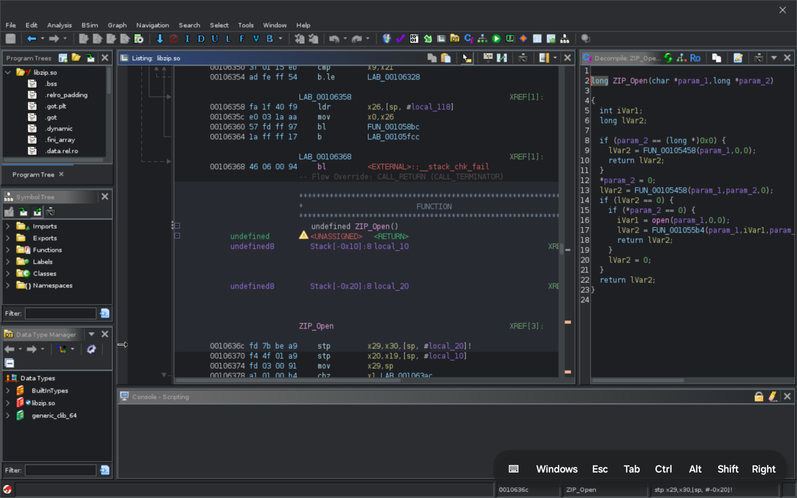
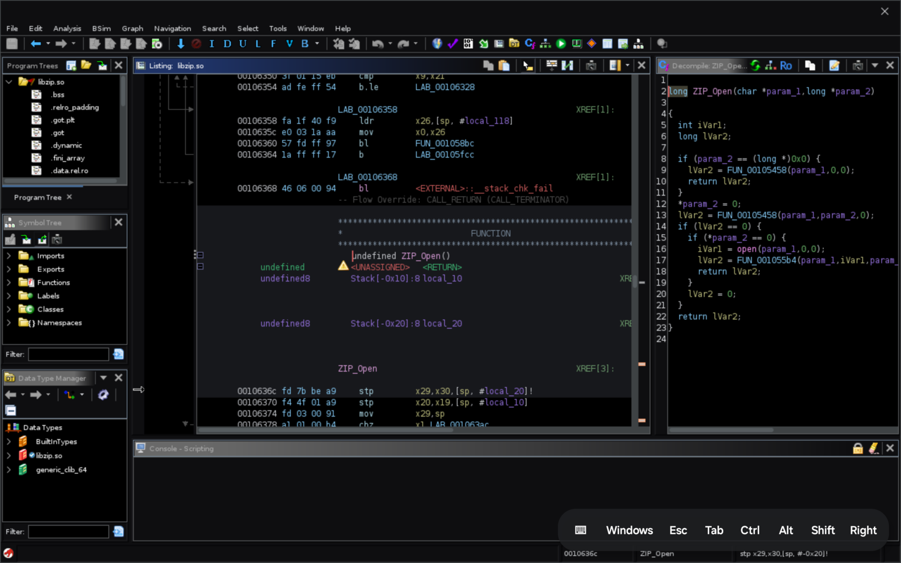

# Ghidra for Android

Run the real [Ghidra](https://github.com/NationalSecurityAgency/ghidra) on an
Android tablet: the full Swing UI, the CodeBrowser, the native decompiler,
auto-analysis and Java scripts. It is tuned for the Samsung Galaxy Tab S11
and works with fingers, the S Pen, a mouse, and a keyboard cover.



This is not a port or a rewrite. The app downloads the official, unmodified
Ghidra release and runs it on an Android build of OpenJDK 21. Ghidra's AWT/Swing
UI is drawn by a toolkit built for the job. Ghidra's native helpers (decompiler,
SLEIGH compiler, GNU demanglers, lzfse) are built for Android with the NDK.

## Install

1. Download the APK from [Releases](../../releases) and install it (arm64
   Android 12 or newer).
2. Open **Ghidra for Android**. It unpacks its Java runtime, then offers to
   **Download Ghidra** (the official release zip from GitHub, about 570 MB,
   checked against GitHub's SHA-256), or to install a release zip you already
   have.
3. Optional: **Allow access to all files**, so Ghidra's file chooser can import
   from shared storage. Without it, use Android's **Share** or **Open with** on
   a file: the app copies it into `~/imports` for Ghidra's import dialog.
4. Tap **Launch Ghidra**.

Ghidra's settings and projects live in the app's private storage (`~` in
Ghidra). The JVM runs in its own process with a foreground notification, so a
long analysis survives switching apps.

## Using it

| Input | Does |
|---|---|
| Tap | Click; tap twice for double-click |
| Drag on code, tables, trees, text | Scroll, with fling |
| Drag on a scroll bar, divider, header or title bar, or in the function graph | Drag |
| Press and hold, then lift | Right-click (context menu) |
| Press and hold, then drag | Select (bytes in the listing, text) |
| Two fingers | Scroll in any direction |
| S Pen hover | Moves the pointer: tooltips and hover previews |
| S Pen tap / with side button | Click / right-click |
| Mouse, trackpad | As on a desktop, including right button, wheel and hover |
| Back gesture or key | Escape (closes menus and dialogs) |

With the Book Cover Keyboard (or any keyboard and touchpad), Ghidra works as
it does on a desktop:
- **Key bar**: hidden while a keyboard is attached; the setting can also be
  Always shown or Always hidden.
- **Window switcher**: works like Alt+Tab. Hold Alt and tap ` to step through
  the windows (Shift+` steps back), then let go of Alt to switch. Esc cancels.
- **Shortcuts**: Ghidra's own keys work as usual.
- **Touchpad**: moves the pointer, with hover tooltips. Tap is a click, a
  two-finger tap is a right-click, and two-finger scrolling scrolls.

The **window tray** in the top-right corner, next to Ghidra's close button,
shows how many windows are open and which one is active. Tap it to list the
windows, and tap one to bring it to the front.

The floating **key bar** (drag it by its keyboard button) has:

- **⌨**: show the soft keyboard. It also opens by itself when you tap into a text field.
- **Windows**: opens the window tray (project window, CodeBrowser, Script
  Manager, ...). On a single screen every window fills it, so this is how you
  reach the ones underneath.
- **Esc**, **Tab**: those keys.
- **Ctrl**, **Alt**, **Shift**: sticky modifiers for the next key or click.
- **Right**: the next tap is a right-click.

With a keyboard cover, Ghidra's shortcuts work as on a desktop (`G` go to, `L`
label, `;` comment, `Ctrl+Shift+E` and so on). The key bar can be hidden in
settings.

Settings on the start screen:

- **Display scale**: screen pixels per Ghidra pixel. The default is about 2×
  on the Tab S11, which gives Ghidra a 1280×800 desktop in landscape. Lower
  values fit more on screen.
- **Java heap**: defaults to half the RAM, up to 8 GB.
- **Extra JVM arguments**: for example `-Dfont.size.override=14` to change
  Ghidra's font size without changing the scale.

- **Ghidra theme**: by default it follows Android's dark mode and switches
  live when dark mode changes. You can instead pin Dark or Light, or choose
  "Set in Ghidra" to keep whatever you pick under Edit → Theme.
- **Pure black (OLED)**: uses a true-black variant of the dark theme. It looks
  best on the Tab S11's AMOLED panel.

Theme changes apply to a running Ghidra immediately.

- **Ghidra windows**: in Samsung DeX or a floating (pop-up) window, each
  Ghidra window, dialog and search box gets its own Android window, so a
  dialog no longer covers the program. Each window can be moved, resized and
  closed on its own, and appears in the taskbar. Elsewhere Ghidra stays on one
  screen. This can also be set to always separate or always one screen.

The screen follows rotation, split screen, DeX windows and the soft keyboard;
Ghidra's windows are re-laid out to fit.

### Touch UI

Touch UI is a Ghidra extension that ships with the app and is on by default.
The app builds it on the device against the installed Ghidra, so it follows
Ghidra upgrades, and it switches itself on in CodeBrowser (no "new plugins"
prompt). It uses only Ghidra's public plugin API and Swing, so the same
extension works on desktop Ghidra.

- **Focus layout** (Window → Focus Layout, Ctrl+Shift+Space): only the
  listing and the decompiler, split evenly. The listing drops its raw bytes
  column, and the toolbar gives way to a row of big buttons along the bottom:
  Back, Forward, Go to, Commands, Panels, Undo, Redo, Save, Show all.
- **Panels** (Ctrl+Shift+O): every other panel (Symbol Tree, Data Types,
  Console, ...). In the focus layout, a panel opened from here is a drawer: it
  hides again as soon as you tap back into the code.
- **Commands** (Ctrl+Shift+P): one search box for every command that can run
  where you are, recent ones first, plus "go to" for addresses and labels.
- **Comfortable sizes**: taller rows in trees and tables and roomier menus.

Each part can be turned off under Edit → Tool Options → Touch UI. Removing the
plugin from a tool (File → Configure) keeps it removed.

On desktop, build `extension/TouchUI` with Gradle
(`gradle -PGHIDRA_INSTALL_DIR=...`), install the zip with File → Install
Extensions, and start Ghidra with `-Dtouchui.touch=true` if you want the touch
defaults.

### Extensions and plugins

**Extensions…** on the start screen manages Ghidra extensions without a
desktop:

- **Installed**: what Ghidra will load, with the version each was built for.
  Remove extensions here.
- **Included with Ghidra**: the optional extensions in the release (Jython,
  SampleTablePlugin, SleighDevTools, MachineLearning, ...). One tap installs
  one.
- **Install zip…**: an extension zip from storage. Sharing a zip to the app,
  or opening one with it, also works. If a zip was built for another Ghidra
  version, the app offers to install it marked for this version (Ghidra
  otherwise refuses to load it).
- **From GitHub…**: give `owner/repo`. If a release has a zip for this Ghidra
  version, it is installed directly. Otherwise the app downloads the source and
  builds it on the device.
- **Build from folder…** and **New from template…**: build an extension
  project from source on the tablet. The template is Ghidra's own Skeleton (an
  analyzer, loader, exporter, file system and a SLEIGH processor). It is copied
  to `Documents/Ghidra extensions/`, where you can edit it with any editor;
  then tap **Build and install**.

Builds use the same layout as Ghidra's `buildExtension.gradle`, without
Gradle: `src/main/java` is compiled with the bundled javac against Ghidra's
jars and `lib/*.jar`, and the result is packaged with `extension.properties`,
`data/` and `ghidra_scripts/`. Direct Maven dependencies written in
`build.gradle` as `implementation 'group:artifact:version'` are downloaded,
but not their own dependencies. Kotlin and native code (`os/`) are not
supported. The build runs in a separate short-lived process, so Ghidra does not
need to be running. Ghidra loads new extensions when it next starts; from the
Extensions screen you can ask a running Ghidra to exit (it offers to save
first). The builder also runs on a desktop JDK:
`java -cp ghidroid-tools.jar:<javac> io.github.xerootg.ghidroid.tools.ExtensionBuilder GHIDRA_DIR PROJECT OUT.zip`.

Ghidra's own File → Install Extensions dialog works too.

### Ghidra Server

Shared projects on a [Ghidra Server](https://github.com/NationalSecurityAgency/ghidra/blob/master/Ghidra/RuntimeScripts/Common/server/svrREADME.md)
work like they do on a desktop. The server has to run the same Ghidra
major.minor version as the app. Under **Ghidra Server** on the start screen:

- **Server**: `host:port` (port 13100 by default). Ghidra then offers it first
  under File → New Project → Shared Project. The tablet must reach TCP ports
  13100 to 13102, either on the LAN or over a VPN such as Tailscale.
- **User name**: the name Ghidra presents to the server. Without it, Ghidra
  uses Android's own user name (`u0_a123`), which no server knows. Servers
  without passwords (no `-a` option) log you in by this name alone. With
  `-a0`, Ghidra asks for the password as usual.
- **Test connection** checks that the three ports answer.

Server and user name apply the next time Ghidra starts. Local projects belong
to the user name that created them, so set the user name before you create
local projects.

### Dark mode

The app adds two Ghidra themes, **Android Dark** and **Android Black**, both
built on FlatLaf Dark. Android Dark uses neutral greys and keeps contrast
low; Android Black is true black for OLED screens. In both, the listing's
current-line band is a subtle tint instead of Ghidra's default bright purple.
Window title bars and borders follow the theme too.

Both themes also appear in Ghidra's own theme list (Edit → Theme), where you
can copy and adjust them. The sources are in [`themes/`](themes).



## What works, what doesn't

Tested on a Galaxy Tab S11 (Android 16) with Ghidra 12.1.4:
- creating a project and importing an ARM64 ELF
- auto-analysis, the listing and the decompiler
- the function graph
- the symbol and program trees
- Java scripts from the Script Manager (javac is bundled)
- Ghidra Help
- rotation and resizing
- the clipboard, which is shared with Android

Everything else in Ghidra is pure Java and is expected to work, but has not been
tried on a device yet.

Not available:

- **PyGhidra** and Python scripts (there is no CPython).
- **Debugger** back ends (gdb, lldb, ...): there are none on Android.
- **7-Zip-backed file systems** (the native library is glibc-only). ZIP, TAR,
  APK and the other Java-backed formats work.
- **Drag and drop** between components.

## How it works

```
Android app (ART)                         :ghidra process
  GhidraActivity ── SurfaceView ─────┐
     touch / pen / mouse / keys ──┐  │
                                  ▼  ▼
                          libghidroid.so  (input queue, ANativeWindow)
                                  ▲  ▲
  HotSpot JVM (Android JRE 21) ───┘  │ frames (RGBX, straight copy)
     Ghidra ─ Swing ─ AWT ─ toolkit.jar (patched into java.desktop)
     decompile, sleigh, demangler: NDK executables, exec()ed from the
     app's native library directory
```

- **One process, two VMs.** `GhidraActivity` runs in a `:ghidra` process and
  starts HotSpot in it with `JLI_Launch` from
  [`bridge.c`](app/src/main/cpp/bridge.c). ART and HotSpot share
  `libghidroid.so`: ART hands it the `Surface` and input events, and HotSpot
  takes frames and input from it. No Java objects cross between the VMs.
- **The toolkit** ([`toolkit/`](toolkit)) is a fork of
  [Caciocavallo](https://github.com/CaciocavalloSilano/caciocavallo)'s managed
  full-screen windows. It is patched into `java.desktop` with `--patch-module`,
  together with a `PlatformGraphicsInfo` that selects it and an
  `X11FontManager` that works without X11 or fontconfig. On top of Cacio it
  adds:
  - a resizable screen whose pixel format is Android's `RGBX_8888`
  - window stacking
  - pointer grabs
  - precise wheel events
  - expose-style repaints
  - a window policy: frames fill the screen, dialogs stay on it
  - clipboard and `Desktop` integration
  - pointer icons
  - a [touch gesture interpreter](toolkit/src/main/java/io/github/xerootg/ghidroid/awt/TouchHandler.java)
    that decides between scrolling and dragging by looking at the Swing
    component under the finger
- **Native tools** are built by [`scripts/prepare.sh`](scripts/prepare.sh) from
  Ghidra's sources and packaged as `lib*.so`. The package manager then extracts
  them to the native library directory, the one place an app may `exec()` from.
  Ghidra finds them through symlinks in `os/linux_arm_64/`.
- **javac** is not in the Android JRE, and its `java.base` pins the hash of
  `jdk.compiler`. So javac from the matching JDK release goes on the class
  path, and a patched `javax.tools.ToolProvider`
  ([`compiler-patch/`](compiler-patch)) finds it there.

## Building

Needs JDK 21, the Android SDK (platform 36) and NDK 29.0.14206865, `curl`,
`zip` and `make`.

```sh
scripts/prepare.sh            # JRE, javac, fonts, toolkit, NDK builds of Ghidra's natives
./gradlew assembleDebug       # app/build/outputs/apk/debug/app-debug.apk
```

`tools/deploy.sh [serial]` rebuilds the toolkit and the APK, installs them and
starts Ghidra (debug builds accept `--ez launch true`).

You can work on the toolkit and on how Ghidra behaves without a device. The
socket back end runs Ghidra on the desktop JDK with the Android toolkit:

```sh
tools/build-toolkit.sh
tools/run-desktop.sh /path/to/ghidra_12.1.4_PUBLIC 1280x800 &
java tools/Viewer.java 7777        # interactive window
java tools/Driver.java 7777 < cmds # scripted input and PNG snapshots
```

## Credits and licenses

- Ghidra is developed by the National Security Agency and released under the
  Apache License 2.0. This project is not affiliated with or endorsed by the NSA.
- OpenJDK 21 for Android comes from
  [AngelAuraMC/angelauramc-openjdk-build](https://github.com/AngelAuraMC/angelauramc-openjdk-build)
  (GPL-2.0 with Classpath exception). javac comes from
  [Eclipse Temurin](https://adoptium.net) 21.0.1.
- [Caciocavallo](https://github.com/CaciocavalloSilano/caciocavallo) (GPL-2.0
  with Classpath exception). PojavLauncher showed that HotSpot and ART can share
  a process.
- DejaVu fonts (Bitstream Vera license).

Code in [`toolkit/`](toolkit) and [`compiler-patch/`](compiler-patch) is
GPL-2.0 with the Classpath exception, as are the projects it derives from. Everything
else is [Apache-2.0](LICENSE).
